# Database design

PostgreSQL 17 with `pgcrypto` and `vector` extensions. UUID primary keys, `timestamptz` everywhere,
foreign keys with explicit `ON DELETE` behaviour, naming convention enforced by SQLAlchemy metadata.
Migrations: `backend/migrations` (Alembic). RLS policies are part of the migrations.

## Roles

| Role | Purpose |
|---|---|
| `wflow_owner` | Owns the schema, runs migrations and `sync-rbac` |
| `wflow_app` | Runtime role: CRUD on tables, **no** UPDATE/DELETE on `audit_logs`, no writes to `permissions`/`role_permissions`, subject to RLS |

## Entities (M1)

```mermaid
erDiagram
  users ||--o{ organization_members : "belongs to"
  organizations ||--o{ organization_members : has
  roles ||--o{ organization_members : grants
  roles ||--o{ role_permissions : has
  permissions ||--o{ role_permissions : in
  organizations ||--o{ roles : "custom roles"
  organizations ||--o{ invitations : sends
  roles ||--o{ invitations : offers
  users ||--o{ refresh_tokens : "sessions"
  users ||--o{ user_action_tokens : "email links"
  organizations ||--o{ audit_logs : records
  users ||--o{ audit_logs : acts
```

| Table | Notes |
|---|---|
| `users` | Platform identity. `email` unique, stored lower-case. `is_superadmin` platform flag |
| `organizations` | `slug` unique, `timezone` (IANA), soft delete via `deleted_at` |
| `permissions` | Code catalogue (`members.invite`, …), synced from `app/core/rbac.py` |
| `roles` | `organization_id NULL` = system role (unique key among system roles); `rank` for hierarchy |
| `role_permissions` | Composite PK |
| `organization_members` | Unique `(organization_id, user_id)`; `status` |
| `invitations` | `token_hash` (SHA-256) unique; partial unique index: one open invite per email per org |
| `refresh_tokens` | `family_id` groups a login session; `revoked_reason` (`rotated`, `logout`, `reuse_detected`, …) |
| `user_action_tokens` | Single-use email verification / password reset tokens (hashed) |
| `audit_logs` | Append-only. `organization_id NULL` for account-level events. Indexed by org/actor + time |

## Row Level Security

Helper functions: `app_current_org_id()`, `app_current_user_id()` read transaction-local settings.

| Table | SELECT | INSERT / UPDATE / DELETE |
|---|---|---|
| `organizations` | active org, or orgs the user is a member of | active org only |
| `organization_members` | active org, or the user's own memberships | active org only |
| `invitations` | active org | active org |
| `roles` | system roles + active org's roles | active org's roles only |
| `audit_logs` | active org, or the user's own account events | insert: active org or account-level |

`invitation_org_by_token_hash(text)` is a `SECURITY DEFINER` function that resolves exactly one invitation
token digest to its organization, so invite links can be opened before any tenant context exists.

## Planned (later milestones)
Channels (`channel_connections`, `channel_sessions`, `channel_events`), messaging (`contacts`,
`conversations`, `messages`, …), automation (`workflows`, `workflow_versions`, `workflow_runs`, `node_runs`, …),
CRM (`leads`, `follow_up_tasks`, …), integrations, billing — each with `organization_id` + RLS.
