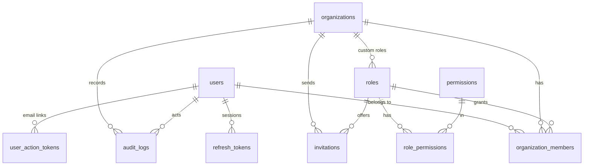

# Database design

PostgreSQL 17 with `pgcrypto` and `vector` extensions. UUID primary keys, `timestamptz` everywhere,
foreign keys with explicit `ON DELETE` behaviour, naming convention enforced by SQLAlchemy metadata.
Migrations: `backend/migrations` (Alembic). RLS policies are part of the migrations.

## Roles

| Role | Purpose |
|---|---|
| `wflow_owner` | Owns the schema, runs migrations and `sync-rbac` |
| `wflow_app` | Runtime role: CRUD on tables, **no** UPDATE/DELETE on `audit_logs`, no writes to `permissions`/`role_permissions`, subject to RLS |

## Entities (M1)

| Table | Notes |
|---|---|
| `users` | Platform identity. `email` unique, stored lower-case. `is_superadmin` platform flag |
| `organizations` | `slug` unique, `timezone` (IANA), soft delete via `deleted_at` |
| `permissions` | Code catalogue (`members.invite`, …), synced from `app/core/rbac.py` |
| `roles` | `organization_id NULL` = system role (unique key among system roles); `rank` for hierarchy |
| `role_permissions` | Composite PK |
| `organization_members` | Unique `(organization_id, user_id)`; `status` |
| `invitations` | `token_hash` (SHA-256) unique; partial unique index: one open invite per email per org |
| `refresh_tokens` | `family_id` groups a login session; `revoked_reason` (`rotated`, `logout`, `reuse_detected`, …) |
| `user_action_tokens` | Single-use email verification / password reset tokens (hashed) |
| `audit_logs` | Append-only. `organization_id NULL` for account-level events. Indexed by org/actor + time |

## Row Level Security

Helper functions: `app_current_org_id()`, `app_current_user_id()` read transaction-local settings.

| Table | SELECT | INSERT / UPDATE / DELETE |
|---|---|---|
| `organizations` | active org, or orgs the user is a member of | active org only |
| `organization_members` | active org, or the user's own memberships | active org only |
| `invitations` | active org | active org |
| `roles` | system roles + active org's roles | active org's roles only |
| `audit_logs` | active org, or the user's own account events | insert: active org or account-level |

`invitation_org_by_token_hash(text)` is a `SECURITY DEFINER` function that resolves exactly one invitation
token digest to its organization, so invite links can be opened before any tenant context exists.

## Channels & messaging (M2)

| Table | Notes |
|---|---|
| `channel_connections` | `channel_type`, `status` (9 states), phone/account name, `session_reference` (opaque), connect/disconnect times, soft delete |
| `channel_events` | Connection log + idempotency ledger (`event_id` unique). Append-only for the app role |
| `contacts` | Unique `(organization_id, channel_type, external_id)`; `consent_status`, `opted_out_at`, `last_inbound_at` |
| `conversations` | Unique `(connection_id, external_chat_id)`; status, last message preview/time, unread count |
| `messages` | Direction, type, content, status; partial unique `(connection_id, provider_message_id)` for dedupe; unique `(organization_id, client_message_id)` for duplicate-send protection |

All five tables use the uniform tenant policy `organization_id = app_current_org_id()`.
`channel_connections_to_restore()` (`SECURITY DEFINER`) returns only `(id, organization_id, channel_type)`
of in-progress/active connections so the gateway can resume them after a restart.

## Inbox & CRM (M3)

| Table | Notes |
|---|---|
| `conversations` (+) | `priority`, `assigned_user_id`, `automation_paused` (human takeover), `resolved_at` |
| `contacts` (+) | `email`, `company`, `custom_fields` JSONB (validated against definitions), `deleted_at` |
| `message_attachments` | `storage_key` (org-prefixed, unique), name, type, size; `message_id` nullable until the gateway's event links it |
| `conversation_notes` | Internal notes |
| `conversation_assignments` | Assignment history |
| `tags`, `contact_tags` | Unique tag name per org |
| `leads` | Fixed stage enum (ADR-007), value/currency, score, owner, expected close, lost reason, `closed_at`, position |
| `follow_up_tasks` | `due_at` timestamptz, assignee, optional contact/lead/conversation links, `completed_at` |
| `customer_activities` | Contact timeline, append-only for the app role |
| `custom_field_definitions` | Unique `(organization_id, entity, key)`; type, options, required, archived |

All M3 tables use the standard tenant policy.

## Workflows (M4)
| Table | Notes |
|---|---|
| `workflows` | name, status (draft/active/paused/archived), `draft_definition` JSONB (React Flow graph), `trigger_type`, `published_version_id`, unique `webhook_token` |
| `workflow_versions` | Immutable (UPDATE/DELETE revoked from the app role): `version`, `definition`, `compiled` plan, publisher; unique `(workflow_id, version)` |
| `workflow_runs` | status QUEUED/RUNNING/WAITING/COMPLETED/FAILED/CANCELLED/TIMED_OUT, `is_test`, trigger type + payload, conversation/contact, `waiting_for`, error, `retry_of_run_id`; partial unique `(workflow_id, trigger_event_key)` de-duplicates triggers |
| `node_runs` | One row per step per run (unique `(run_id, node_id)`): status, attempt, input/output, outcome, error |
| `approvals` | Pending/approved/rejected/expired/cancelled decisions with assignee, decider, note, expiry |

All use the standard tenant policy. `workflow_by_webhook_token(text)` (SECURITY DEFINER) resolves a public
webhook token to its active workflow and organization before the tenant context exists.

## Schedules & Templates (M5)

| Table | Notes |
|---|---|
| schedules | organization_id, workflow_id, name, description, status (active/paused), schedule_type (daily/weekly/monthly/cron/once), config JSONB, 	imezone, 	arget_tag_id (optional audience broadcast), last_run_at, 
ext_run_at, 	otal_runs |
| workflow_templates | organization_id (NULL for system templates), name, description, category, definition JSONB, is_system |

### RLS Policies (M5)
- schedules: standard tenant policy USING (organization_id = app_current_org_id()) WITH CHECK (organization_id = app_current_org_id()).
- workflow_templates: SELECT where `is_system OR organization_id = app_current_org_id()`; INSERT/UPDATE/DELETE only on the organization's own non-system rows, so shared system templates are read-only even to raw SQL.
- `schedule_org_by_id(uuid)` (SECURITY DEFINER) maps a firing schedule to its organization before the tenant context exists.

### Analytics Indexes (M5)
- messages (organization_id, created_at, direction)
- conversations (organization_id, created_at, status)
- leads (organization_id, stage)
- contacts (organization_id, created_at)
- ollow_up_tasks (organization_id, due_at, completed_at)

## Commercial Platform (M6)

| Table | Notes |
|---|---|
| plans | Global catalog: key, name, description, price_cents_monthly, price_cents_yearly, currency, limits JSONB, features JSONB, is_active |
| subscriptions | organization_id, plan_id, status (active/trialing/canceled/past_due), billing_interval, current_period_start, current_period_end, trial_end, cancel_at_period_end, provider, provider_customer_id, provider_subscription_id |
| usage_counters | organization_id, year_month (YYYY-MM), workflow_runs_count, outbound_messages_count, last_reset_at; UNIQUE(organization_id, year_month) |
| invoices | organization_id, invoice_number, amount_cents, currency, status, period_start, period_end, pdf_url |
| processed_provider_events | provider, event_id, event_type, payload JSONB, processed_at (replay protection for webhook ingestion) |
| webhooks | organization_id, name, target_url, events text[], secret_hash, is_active, consecutive_failures, disabled_reason |
| webhook_deliveries | organization_id, webhook_id, event_type, event_id, payload JSONB, response_status, response_body, duration_ms, attempt, success, error |
| integration_credentials | organization_id, name, type (api_key/bearer/basic), encrypted_secret (AES-256-GCM), masked_secret |

### RLS Policies (M6)
- plans: SELECT policy `is_active = true` (or superadmin); tenant writes revoked.
- subscriptions, usage_counters, invoices, webhooks, webhook_deliveries, integration_credentials: standard tenant isolation `organization_id = app_current_org_id()`.
- Superadmin policies: `app_current_user_is_superadmin()` grants read access across organizations for the platform administration console and allows audit logging inserts without tenant context (`audit_superadmin_insert`).
- `org_id_by_stripe_customer_or_sub(p_cust, p_sub)` (SECURITY DEFINER) resolves the tenant organization for external billing webhooks prior to establishing RLS context.

## Planned (later milestones)
Hardening & observability (M7), AI track.
